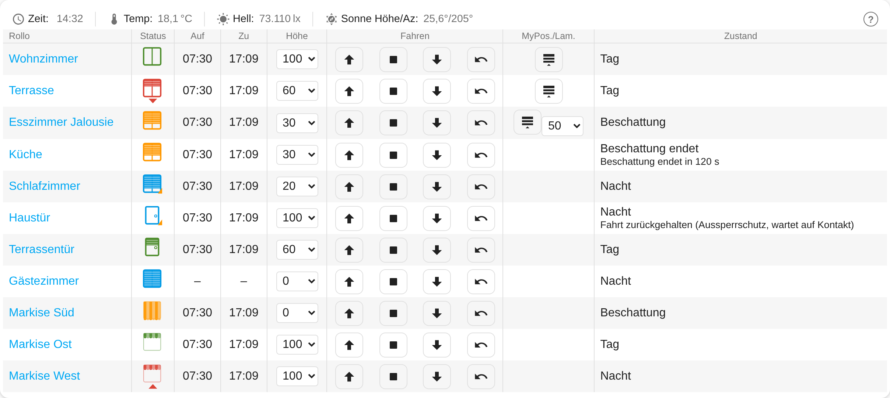

# Rollladen Steuerung (Shutter Control)

*Deutsche Version: [README.md](README.md)*



Connects **day/night** (e.g. from "Rollladen Zeiten"), sensors and a window contact with a **cover** shutter/blind.
One instance per shutter (Settings → Devices & services → add "Rollladen Steuerung"). When adding an instance you only choose the shutter and its input entities; **all values are entities of the device afterwards** and survive a restart. Position: 0 % = closed, 100 % = open (as in HA).

> Note: entity names and the card are currently localized in German and English; the automation texts in diagnostic sensors (e.g. "Fahrt verzögert") are German.

## Setup (inputs when adding the instance)

Only *shutter* and *day or day/night* are **mandatory**. Everything else is **optional**; what is missing is simply not evaluated (e.g. no brightness sensor = the brightness condition of shading is skipped) and the related entities/columns do not appear.

| Field | Mandatory? | Notes |
|---|---|---|
| Shutter (cover) | **mandatory** | The shutter/blind to control |
| Day or day/night | **mandatory** | **One** entry: binary sensor (`on` = day) or sensor (`day`/`tag` = day, `night`/`nacht` = night). Day/night is generated by the separate integration **[Rollladen Zeiten](https://github.com/Reinhard-M/ha-rollladen-zeiten)** (sensor *Day* or *Day/night*, from sun position, time limits and days off); any other source works too |
| Device type | default *window* | Window, door or awning. *Door*: lock-out protection on by default, shown as a door in the card. *Awning*: own day/night behaviour (see section *Awning*), shown as an awning in the card. Changing the type resets these defaults |
| Position source | default from the cover's capabilities | *From device* (set_cover_position/current_position) or *Internal* (estimate from run times). **Run times and calibration exist only for *Internal*** |
| Use slats | default from capabilities | Slats are set via `set_cover_tilt_position` (0–100 %). **Off = all slat entities are omitted** |
| Window contact | optional | Entity with a text state; the words for open/tilted/closed are configurable (comma list, default `open,on` / `tilted,tilt` / `closed,off`). Without a contact "closed" is assumed |
| Brightness, outdoor temperature, room temperature | optional | Sensors; not selected = condition of shading is skipped |
| Sun elevation / azimuth | optional | Sensors or `sun.sun` (attributes); not selected = condition skipped |
| External command | optional | Sensor whose state is executed as a command; every state change triggers it. All commands: see section *External command* |
| External block | optional | **Binary** input (`binary_sensor`, `input_boolean`, `switch`, sensor): `on`/`true` blocks the automation, `off`/`false` releases it. See section *Blocking the automation* |
| Drive time morning/evening | optional | Display only, in the card: sensor with a time (e.g. "Rollladen Zeiten") |
| MyPosition button on the device | optional | Button/switch/script that moves the motor to its MyPosition (intermediate position). **Empty = no *MyPosition* button and no *MyPosition* choice in the settings** |
| Homematic device / channel | optional | See section *Blinds and slats* |

## Settings (entities of the device)

All values are entities of the device and are kept across restarts. Defaults are chosen so that the controller works without adjustment; "only if" names the precondition for the entity to exist at all.

| Setting | Default | Effect / only if |
|---|---|---|
| Night window open / closed / tilted (position) | 100 / 0 / 20 % | Night target height per contact state. **Omitted for awnings** (fixed there: retract) |
| Night … type (per contact state) | position | Position or MyPosition; only with a MyPosition button |
| Day height / day height type | 100 % / position | Target when switching to day; type only with a MyPosition button |
| Shading height / shading type | 30 % (awning 0 %) / position | Shading target; type only with a MyPosition button |
| Shading elevation min. | 10 ° | Sun must be at least this high |
| Shading azimuth from / to | 90 ° / 270 ° | Sun must be within this range (also across north) |
| Shading outdoor / room temperature min. | 20 / 22 °C | only if the sensor is configured |
| Shading brightness start / end | 30000 / 20000 lx | only with a brightness sensor; end < start avoids flapping |
| Shading end delay | 300 s | How long a condition must be violated before shading ends |
| Shading end | previous position | Afterwards go to previous position or day position |
| Catch-up delay | 30 s | Wait before a drive held back by lock-out protection is made up |
| **Automatic drive delay** | 0 s (off) | Delays every **automatic** drive (see Logic); manual drives never |
| Slats night (open/closed/tilted) / shading / day | 100 / 0 / 50 / 50 / 100 % | only with *Use slats* |
| Run time down / up | 30 s | only with position source *Internal*; calibration possible |
| MyPosition height | 50 % | only with *Internal* and a MyPosition button; calibration possible |
| Switch *Lock-out protection* | off (on for type *door*) | see Logic |
| Switch *Shading* | on | off = no shading |
| Switch *Automation blocked* | off | Blocks the automation (party mode). If the input *External block* is configured, the **switch follows the input** (at startup and on every change) and can be overridden by hand in between |
| Switch *Hide run times* | off | hides run times/calibration |

## Logic

**Night** (top level): allows only the drives from the settings *Night window open / closed / tilted*. Each one is a **position** (with a % value) or **MyPosition** – only these two kinds, no up/down. At night only night values apply, never shading values. It runs on the switch to night and on every change of the window contact (unknown contact = closed). With slats, *Night slats window open / closed / tilted* is set afterwards.

**Lock-out protection** (switch on; default on for device type *door*, otherwise off): applies **only** if the shutter is **up**, the contact reports `open` and an **automatic** drive would start. That drive is held back. When the contact reports something else, it is made up after the **catch-up delay** – to the **currently valid target**, not the original position. If the contact returns to `open` before that, the catch-up is dropped. If the shutter is not up, it drives normally.

**Day**: switching to day drives to the **day position** (*Day height type*: position or MyPosition, with *Day height*), unless shading is due immediately. **Shading** starts immediately when **all** configured conditions are met: elevation ≥ limit, azimuth within from–to (also across north), outdoor temperature ≥, room temperature ≥, brightness ≥ *start*. It drives to *Shading height* or (setting *Shading type* = MyPosition) to MyPosition. Window contacts have no effect during the day. Slats: *Shading slats*, then *Day slats*.

**End of shading**: if **one** condition is no longer met (brightness now against the *end* value), **one** timer starts (*Shading end delay*). If all are met again, it is reset. When it expires, the shutter drives, depending on *Shading end*, to the **previous position** (before shading; after the night = up) or to the **day position**. The targets are driven as positions.

**Automatic drive delay** (number, seconds, default 0 = off): delays every **automatically** generated drive (day/night, shading, catch-up) by this time. Useful so that commands do not interfere with each other on "all shutters down" – set different values per shutter (e.g. 0, 2, 4 s …). Manual drives (buttons, Back, position/slat changes, external command) are **never** delayed. If a new target arrives while waiting, it replaces the waiting one.

**Awning** (device type *Awning*): The control logic is the same as for shutters, i.e. **100 % = retracted, 0 % = extended**. The day/night behaviour differs:

* **Night**: at the start of the night the awning is **retracted** (100 %). At night the automation never extends. Window contact and lock-out protection have no effect; the settings *Night …*, *Slats* and *Lock-out protection* are omitted.
* **Day**: switching to day does **nothing**. The awning is extended only by **shading** (sun, brightness, temperature …) to *Shading height* (default **0 %**, i.e. fully out). If shading is due immediately at the start of the day, it extends then.
* **End of shading** and the start of the night retract (depending on *Shading end* to the previous position or *Day height*, default 100 %).
* Delays, *Back*, *MyPosition* and blocking the automation work as for shutters. Wind/rain protection is not part of the integration; it can be connected via the external commands (`up` and the input *External block*).

**Blocking the automation (party mode, wind/rain)**: While the switch *Automation blocked* is on (it follows the input *External block*: `on`/`true` turns it on, `off`/`false` off; it can be switched by hand at any time, the next change of the input applies again), the automation does **not** drive; manual drives (buttons, external command) still work. What the automation wanted to drive meanwhile (day/night, shading, contact change) is **remembered**. When the block ends (switch off, by hand or via the input), it drives **once to the then valid target** (drive delay and lock-out protection still apply). If nothing was held back, the shutter stays as it is. If the input is `unknown`/`unavailable`, the last state is kept. The switch survives a restart; if an input is configured it is read at startup and sets the switch state; *Drive delayed* shows "Automatik gesperrt, Fahrt wartet auf Freigabe". Party example: open the shutters that should stay open with `up` and set the input to `on`, after the party to `off`. Wind/rain: switch the input from your own wind/rain logic (e.g. `up` via command, input `on`; the end of the block catches up the then valid automation).

## External command

The sensor chosen when adding (e.g. an `input_select`, template or MQTT sensor) triggers a command on **every state change** (case-insensitive). It counts as manual: the automation is untouched and there is no drive delay.

| State | Effect |
|---|---|
| `up` / `hoch`, `down` / `runter`, `stop` / `stopp` | Buttons Up / Down / Stop |
| `mypos` / `shade` / `beschattung` | Go to MyPosition |
| `back` / `zurück` | Back to the last automatic position |
| `position:40`, `position 40`, `pos=40`, `40`, `40 %` | Drive to **position** 40 % (0–100; also for shutters, with slats the current slats are kept) |

Note: if the sensor repeats the same state there is no state change and thus no new command (e.g. `position:40` twice in a row).

**Manual commands** (buttons, external command, directly on the device) are ignored by the automation and do not block it. The automation only drives on an **event** (day/night switch, contact, shading start/end, catch-up); it never checks the position periodically. If the shutter was moved during shading, it therefore only goes up again when shading ends.

**Back**: the *Back* button (or external command `back`/`zurück`) drives, after a manual drive, to the last **automatically** driven position of the current time of day (night or day/shading). Lock-out protection does not apply here.

**Hide run times**: the switch *Hide run times* hides run times, MyPosition height and calibration in the settings (entity registry "hidden"); off = visible again. The values stay in effect.

## Blinds and slats

Slat control is **not** limited to Homematic. With *Use slats* the slat position is set via the standard Home Assistant action `cover.set_cover_tilt_position` (0–100 %), the height via `cover.set_cover_position`. Any blind whose integration offers these two actions (Z-Wave, Zigbee, KNX, Shelly, Somfy, Homematic, …) can be controlled with individual slat values.

Only the optional field **Homematic device / channel** is Homematic specific: height and slats are then sent in **one** command (`homematicip_local.put_paramset`, datapoint `COMBINED_PARAMETER`, e.g. `L=50,L2=80`, values in percent) instead of two separate commands. This helps with actuators like the HmIP-FBL, where a plain height command resets the slats and height and slats would otherwise fight each other. Leave empty = two commands as with any other blind. For other brands with the same problem there is no such variant yet; the sequence is height first, then slats.

## Position substitute and calibration (source "Internal")

If a shutter has no position feedback (or it is too imprecise), the integration estimates the position from direction and run time and stops partial drives with a timer. Settings: *Run time down* and *Run time up* (each for the whole way 100 % ↔ 0 %), *MyPosition height* (estimated height of MyPosition, default 50 %).

Enter values by hand **or** by calibration: set the **Calibration** select to *1 Down* (the steps run one after another) and use the buttons **Up / Down / MyPosition / Stop**. Every measurement ends with **Stop**.

| Step | Start position | Start with | Stop at | Result |
|---|---|---|---|---|
| 1 Down | up | Down or MyPosition | bottom | *Run time down* |
| 2 Up | bottom | Up or MyPosition | top | *Run time up* |
| 3 MyPosition (only with MyPosition button) | up | MyPosition | as soon as the motor stops by itself | *MyPosition height* |

Start and end of each measurement follow the movement reports of the device (`opening`/`closing` until `open`/`closed`) if it provides them. This way neither the delay of a long MyPosition key press nor the reaction time at Stop is counted. Without such reports, key press and *Stop* count. Step 3 computes the MyPosition height from the measured time and *Run time down* (step 1 must have been done before). The motor stops at MyPosition by itself – press *Stop* as fast as possible, the reaction time goes into the result (1 s ≈ 5 % at 20 s run time); repeat to verify if needed. Afterwards the select jumps to *Off*. If the shutter itself reports `closing → closed` or `opening → open`, the measurement also ends without *Stop*. A hint text is in the `hint` attribute of the select. Because of the latency between command and start of movement, it is worth repeating the measurement several times.

## More entities

* **External command**: fed by the sensor chosen when adding (see section *External command*), no own select on the device.
* **Diagnostic** (category Diagnostic, in the device under "Diagnostic"):
  * *Input day / window contact / brightness / outdoor temperature / room temperature / elevation / azimuth / external command / external block*: the value the controller currently reads from the input (attributes: source, raw value). Only for configured inputs.
  * *Drive delayed* ("Fahrt verzögert"): e.g. "Beschattung endet in 120 s", "Nachholen in 20 s", "Fahrt zurückgehalten (Aussperrschutz, wartet auf Kontakt)", "Automatische Fahrt in 3 s", otherwise "keine"; attribute `faellig_um` (due at).
  * *Last command*: the last command sent to the shutter with time and **trigger** (e.g. "Kontakt closed -> tilted: cover.set_cover_position position=20"); attribute `protokoll` = the last 12 commands. If a command shows up at the shutter that is missing here, it does not come from this integration.
  * *Diagnostics*: `ok`, "Eingang fehlt" (entity currently delivers no value) or "Konfigurationsfehler, Entität fehlt" (entity does not exist); attributes also contain all raw values, conditions and states.
* Buttons *Up, Down, Stop, Back* (and *MyPosition* if a MyPosition button is configured), sensor *State* (night / day / shading / shading ending, attributes with the individual conditions), number *Position* (actual value, setting = manual position drive) and with slats *Slats*, binary sensor *Shading active*, switch *Shading* (off = no shading).

## Renamed or missing entities

* If an entity an instance refers to is renamed (e.g. "Recreate entity ID"), the integration takes over the new entity ID into its settings automatically. This also works for renames while the instance was not loaded (the integration remembers the internal registry ID of every entity).
* If an entity does not exist (anymore), an entry appears under **Settings → Repairs**. A replacement entity can be selected right there; a field left empty removes the input.
* If the MyPosition button is missing, the automation drives to the configured position instead of not driving at all; the command log shows a note.

## Lovelace card "Rollladen Steuerung"


**What the screenshot shows** (top to bottom):

| Row | Shows |
|---|---|
| Info row | Time, outdoor temperature, brightness, sun elevation/azimuth (optional, entities chosen in the card editor) |
| Wohnzimmer | Day: **green** icon, shutter up, *MyPosition* button available |
| Terrasse | **Red** icon with arrow: shutter is **moving** (arrow down = closing, up = opening) |
| Esszimmer Jalousie | Shading: **yellow**, stationary icon; blind with *slats* select next to the MyPosition button (shared column *MyPos./Lam.*) |
| Küche | End of shading running: yellow, column *Zustand* (state) shows the remaining end-delay time |
| Schlafzimmer | Night: **blue** icon; **orange triangle** = window tilted |
| Haustür | Device type *Door*: **door icon** with handle. Night, door **open** (triangle); the automation holds the drive back (lock-out protection), visible as text in *Zustand* |
| Terrassentür | Door during the day: green door icon, 60 % closed (fill from the top) |
| Gästezimmer | No drive-time sensor configured: columns *Auf*/*Zu* show "–"; no MyPosition button and no slats: column *MyPos./Lam.* stays empty |
| Markise Süd | Device type *Awning*: **striped cloth with scallops**; shading (yellow), **fully extended (0 %)** |
| Markise Ost | Awning during the day **retracted (100 %)**: only the narrow roll (green) |
| Markise West | Retracted at night (blue) and currently **retracting** (red with arrow up) |

The columns *Auf*/*Zu* (open/close times) and *Zustand* (state) are optional (card editor: *Show drive times*, *Show state*). Hovering over the icon shows state, movement, window and position as a tooltip. The card UI is German or English depending on the HA language.

Table for manual control and monitoring (one row per shutter). Columns are separated by lines; the four buttons count as **one** column *Fahren* (move): **Name** (link to the device page) | **Status** (window icon, shutter level graphically; colour: green = day, yellow = shading, blue = night, red = moving; triangle = window/door open or tilted) | **Height** (select 100…0 %) | **Up** | **Stop** | **Down** | **Back** | **MyPosition** (only with a MyPosition button) | for blinds additionally the **slats** select (shared column with MyPosition). Plus **drive times** (open/close, from the time sensors chosen when adding, e.g. from "Rollladen Zeiten") and a compact **header row**. Optional: an **info row** above the table with the current **time** (option *Time in the info row*, default on, with seconds if *Show seconds* is active), outdoor temperature, brightness, elevation and azimuth, with labels and icons. The values are chosen once centrally in the card editor (*Info row: …*, any entity each; `sun.sun` also works for elevation/azimuth); empty fields are not displayed.

The card registers itself as a dashboard resource at startup and updates the entry on changes (Lovelace in storage mode; otherwise via `extra_module_url`). After an update clear the browser cache, Ctrl+F5. To add it: edit dashboard → add card → **Rollladen Steuerung**, then choose the devices. Without the editor:

```yaml
type: custom:rollladen-steuerung-card
title: Shutters
devices:            # device IDs (easiest to choose in the card editor)
  - 0123456789abcdef0123456789abcdef
show_state: false
show_times: true      # drive-time columns (only if time sensors are configured)
show_seconds: false   # times with seconds
show_header: true     # header row
show_clock: true      # time in the info row
show_help: true       # "?" icon linking to this documentation
info_outdoor: sensor.outdoor_temperature   # info row (all optional)
info_brightness: sensor.brightness
info_elevation: sun.sun
info_azimuth: sun.sun
```

The card operates the entities *Position* and *Slats* (number, shows the actual value, setting drives the shutter) and the buttons. Manual drives do not influence the automation.

## Installation

### Via HACS (recommended)

1. Open HACS → menu (⋮) → **Custom repositories**.
2. Add `https://github.com/Reinhard-M/ha-rollladen-steuerung` with category **Integration**.
3. Search for "Rollladen Steuerung" in HACS, **Download**, then **restart** Home Assistant.
4. Settings → Devices & services → Add integration → "Rollladen Steuerung".

### Manual

Copy the folder `custom_components/rollladen_steuerung` from this repository to `/config/custom_components/` and **restart** Home Assistant.

## Help

The **?** icon (question mark in a circle) in the Lovelace card and the *Documentation (README)* link in the settings dialogs lead to this page. The icon can be hidden in the card editor (`show_help: false`). Please report bugs and wishes as an [issue](https://github.com/Reinhard-M/ha-rollladen-steuerung/issues).

## Disclaimer

* This is a **private hobby project** and an **unofficial community integration**. It is not affiliated with Home Assistant, the Open Home Foundation, Nabu Casa, eQ-3/Homematic IP, Jarolift, Somfy or any other manufacturer mentioned; all names and trademarks belong to their respective owners and are used only to describe compatibility.
* The software is provided **"as is" without warranty of any kind** (see [LICENSE](LICENSE)). Use it at your own risk.
* It is **not a safety device**. It does not replace wind, rain or frost sensors, nor the pinch protection or obstacle detection of the drives. Moving shutters, blinds, awnings and doors can endanger people and property; the automation moves without presence detection.
* Test new settings while you are present and make a backup before updates.

## License

[MIT License](LICENSE) © 2026 Reinhard-M
